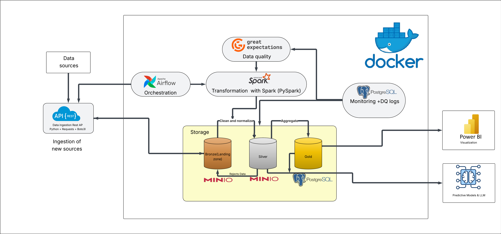
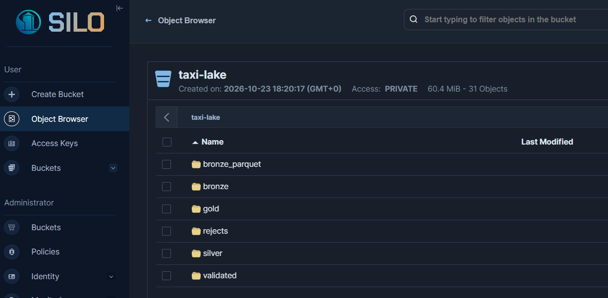
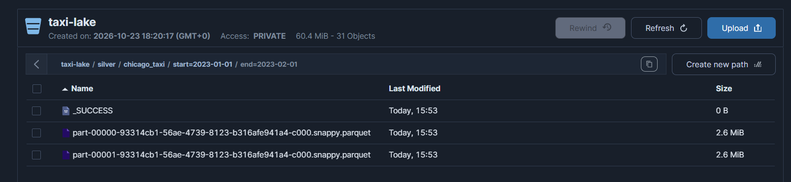
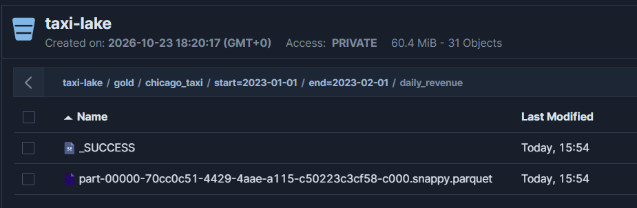
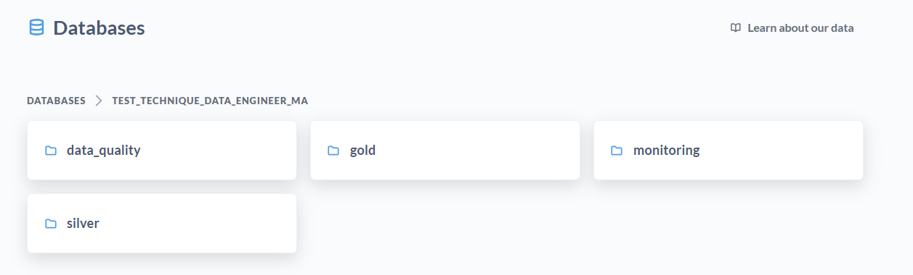
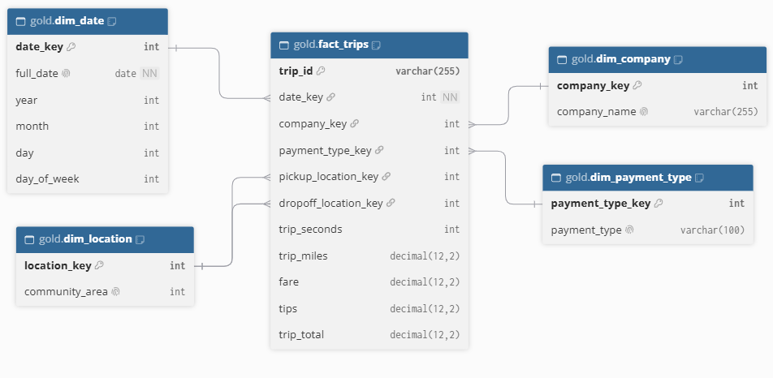
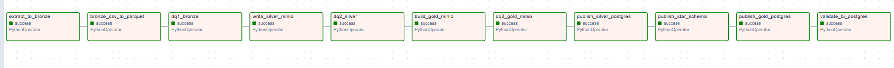
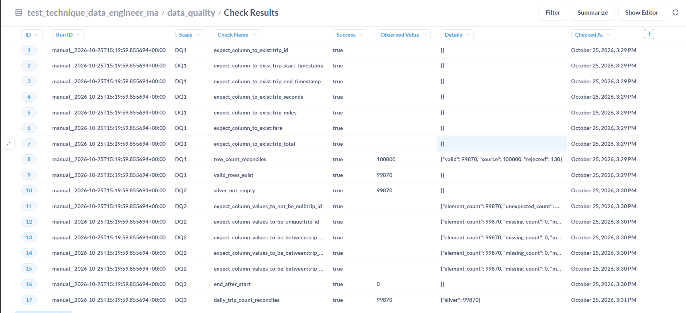
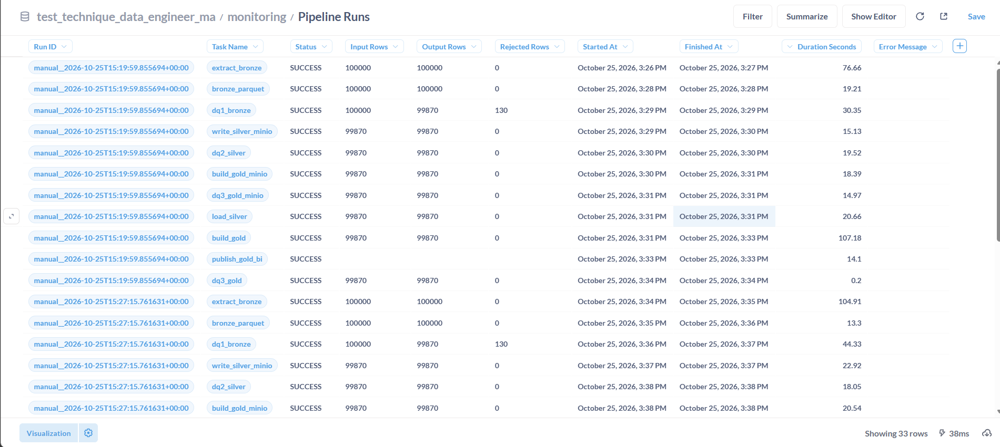
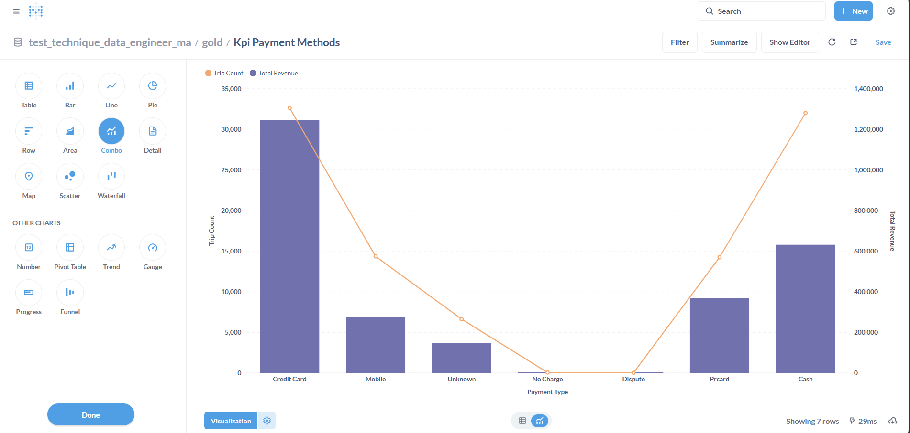

# Chicago Taxi Trips — Pipeline Data Engineering (Medallion)

## 1. Objectif et périmètre

Ce projet vise à concevoir un pipeline Data Engineering de bout en bout à partir des données **Chicago Taxi Trips**, en utilisant **Apache Airflow** pour l’orchestration, **PySpark** pour le traitement et **MinIO** pour le stockage selon une architecture médaillon (Bronze, Silver, Gold). **Great Expectations** assure la qualité des données à travers trois niveaux de validation (DQ1, DQ2, DQ3), avec gestion des données valides et rejetées. **PostgreSQL** permet l’exposition SQL, la modélisation dimensionnelle et le **monitoring du pipeline** (statut des tâches, volumes traités, données rejetées, temps d’exécution et erreurs), ainsi que la traçabilité des contrôles qualité. **Metabase** assure la visualisation des KPI. L’ensemble est déployé localement avec **Docker Compose**, garantissant une solution automatisée, supervisée et reproductible.

**Périmètre de démonstration :** du **1er janvier 2023 inclus au 1er février 2023 exclu**, avec un plafond de **100 000 lignes**, extraites par pages de **10 000**. Le plafond permet une exécution raisonnable sur un ordinateur local ; il ne correspond pas nécessairement à l'intégralité des trajets de cette période.


### 1.1. Architecture globale



Le projet repose sur une architecture **Data Lake Medallion (Bronze, Silver, Gold)**, orchestrée par **Apache Airflow** et déployée localement avec **Docker Compose**.

### 1.2. Composants de l'architecture

| Composant | Technologie | Rôle |
|---|---|---|
| **Source** | Chicago Taxi Trips API SODA | Extraction des données CSV |
| **Ingestion** | Python, Requests, Boto3 | Extraction et chargement des données brutes |
| **Stockage** | MinIO / Silo | Stockage objet des couches Bronze, Silver et Gold |
| **Transformation** | Apache Spark (PySpark) | Nettoyage, déduplication et agrégations |
| **Data Quality** | Great Expectations | Contrôles qualité DQ1, DQ2 et DQ3 |
| **Orchestration** | Apache Airflow | Automatisation et suivi du pipeline |
| **Data Warehouse** | PostgreSQL | Exposition SQL, modélisation en étoile et KPI |
| **Monitoring** | PostgreSQL | Suivi des exécutions, erreurs, volumes et contrôles qualité |
| **Visualisation** | Metabase | Tableaux de bord et analyse des KPI |
| **Déploiement** | Docker Compose | Exécution locale et reproductible |

### 1.3. Flux de données

```text
Chicago Taxi Trips (API SODA)
              |
              v
       Python + Boto3
              |
              v
      MinIO — BRONZE
        CSV + Parquet
              |
              v
      PySpark + DQ1
         /         \
        v           v
   VALID DATA    REJECTED DATA
        |           |
        v           v
  MinIO — SILVER  MinIO — REJECTS
        |
        v
    DQ2 + PySpark
        |
        v
    MinIO — GOLD
     KPIs Parquet
        |
        v
   DQ3 — Validation
        |
        v
      PostgreSQL
   SQL + Star Schema
        |
        v
       Metabase
    BI Dashboards
```

### 1.3. Contrôles qualité

Les contrôles qualité sont réalisés avec **Great Expectations** à trois niveaux :

- **DQ1 — Bronze :** validation du schéma et des données, séparation des enregistrements valides et rejetés.
- **DQ2 — Silver :** vérification des valeurs nulles, des doublons et des règles métier.
- **DQ3 — Gold :** validation des agrégations, des KPI et réconciliation des volumes.

Les données rejetées sont conservées dans `rejects/` sur MinIO pour permettre leur analyse.

### 1.4. Monitoring et visualisation

Le suivi du pipeline est centralisé dans **PostgreSQL** :

- `monitoring.pipeline_runs` : statut des tâches, volumes traités, rejets, durées et erreurs.
- `data_quality.check_results` : résultats et traçabilité des contrôles qualité.

Les données Silver et Gold sont également exposées dans PostgreSQL pour faciliter les **requêtes SQL**, la **modélisation dimensionnelle (Star Schema)** et la **visualisation des KPI avec Metabase**.

**Point architectural important :** MinIO constitue le stockage principal des trois couches Bronze, Silver et Gold. PostgreSQL intervient en complément comme couche de service analytique, de monitoring et de visualisation BI.


## 2. Prérequis et démarrage du projet

### 2.1. Prérequis

- **Docker Desktop** avec Docker Compose v2, démarré et configuré pour les conteneurs Linux (Windows 11 / PowerShell ou Linux).
- **Ports disponibles :** 8080 (Airflow), 9000 (API S3), 9001 (MinIO/Silo), 5433 (PostgreSQL Warehouse) et 3000 (Metabase).
- **Configuration :** créer le fichier `.env` à partir de `.env.example` et renseigner les identifiants nécessaires. 

### 2.2. Configuration de l'environnement

À la racine du projet, où se trouve `docker-compose.yml`, exécuter :

```powershell
Copy-Item .env.example .env
notepad .env
```

Configurer les paramètres d'ingestion et de connexion dans `.env` :

```dotenv
TAXI_START=2023-01-01T00:00:00
TAXI_END=2023-02-01T00:00:00
TAXI_MAX_ROWS=100000
TAXI_PAGE_SIZE=10000

S3_BUCKET=taxi-lake
S3_ENDPOINT=http://minio:9000

WAREHOUSE_HOST=warehouse
WAREHOUSE_PORT=5432
WAREHOUSE_DB=taxi
WAREHOUSE_USER=taxi
```

Renseigner également les identifiants MinIO/Silo et PostgreSQL.

### 2.3. Lancement avec Docker Compose

```powershell
# Préparer le dossier des logs Airflow
New-Item -ItemType Directory -Force logs | Out-Null

# Construire et démarrer les services
docker compose up -d --build
```

### 2.4. Accès aux services

| Service | Adresse locale | Utilité |
|---|---|---|
| **Apache Airflow** | `http://localhost:8080` | Orchestration, exécution et suivi des DAGs |
| **MinIO / Silo** | `http://localhost:9001` | Exploration des données Bronze, Silver, Gold et Rejects |
| **Metabase** | `http://localhost:3000` | Visualisation des KPI et tableaux de bord |
| **PostgreSQL Warehouse** | `http://localhost:5433` | Requêtes SQL via DBeaver ou pgAdmin |

Pour connecter **Metabase à PostgreSQL**, utiliser les paramètres suivants :

- **Type :** PostgreSQL
- **Hôte :** `warehouse`
- **Port :** `5432`
- **Base de données :** `taxi`
- **Identifiants :** définis dans le fichier `.env`

## 3. Choix techniques et arbitrages

| Besoin | Technologie retenue | Alternatives | Justification / compromis |
|---|---|---|---|
| **Ingestion** | Python (`requests`, `boto3`) | Apache NiFi, Kafka, Snowflake Openflow | Solution légère et adaptée à une API REST paginée. NiFi/Openflow serait pertinent pour intégrer plusieurs sources hétérogènes. |
| **Orchestration** | Apache Airflow | Dagster, Prefect | Orchestration des différentes étapes du pipeline, gestion des dépendances, suivi des exécutions et des erreurs. |
| **Transformation / Processing** | Apache Spark / PySpark | **dbt, Pandas, Polars, DuckDB** | PySpark permet le traitement distribué et les transformations sur les fichiers Parquet du Data Lake. dbt serait pertinent pour les transformations SQL directement dans un Data Warehouse. |
| **Stockage médaillon** | MinIO/Silo (S3) + Parquet | Amazon S3, HDFS, Snowflake | Stockage objet local des couches Bronze, Silver et Gold, sans dépendance à une infrastructure cloud payante. Snowflake constitue une alternative de plateforme de données, et non un stockage objet directement équivalent à MinIO. |
| **Data Quality** | Great Expectations + Spark/SQL | Soda, Deequ, dbt Tests | Contrôles qualité DQ1, DQ2 et DQ3, gestion des données valides/rejetées et traçabilité des validations. |
| **Exposition SQL / BI** | PostgreSQL | Snowflake, DuckDB, ClickHouse, Trino | Facilite les requêtes SQL, la modélisation dimensionnelle et l'exposition des données à des outils BI. |
| **Monitoring** | PostgreSQL + Airflow | Prometheus, Grafana | Centralisation des statuts d'exécution, volumes traités, rejets, erreurs et résultats des contrôles qualité. |
| **Visualisation** | Metabase | Power BI, Tableau, Superset | Solution open source, simple à déployer avec Docker et choisie principalement pour tester la connexion à PostgreSQL, explorer les données et visualiser les KPI. |
| **Déploiement** | Docker Compose | Kubernetes | Déploiement local reproductible, simple à configurer et à exécuter sans infrastructure externe. |

**Arbitrage principal :** privilégier une architecture locale, simple et reproductible, tout en conservant des technologies couramment utilisées en entreprise. **MinIO** assure le stockage des couches Bronze, Silver et Gold, **PySpark** réalise les transformations, tandis que **PostgreSQL** facilite l'exploitation SQL, le monitoring et la connexion aux outils BI.

**Arbitrage principal :** privilégier une architecture conforme au sujet (stockage objet pour **les trois couches**) plutôt qu'une variante Silver/Gold directement dans PostgreSQL. PostgreSQL reste utile pour servir les KPI à Metabase.

## 4. Organisation du stockage objet

```text
taxi-lake/
├── bronze/           # CSV d'origine, conservés
├── bronze_parquet/   # Conversion technique du Bronze
├── validated/        # Données validées après DQ1
├── rejects/          # Enregistrements invalides, motifs et métadonnées
├── silver/           # Trajets nettoyés au format Parquet
└── gold/             # Agrégations Parquet
    └── chicago_taxi/start=2023-01-01/end=2023-02-01/
        ├── daily_revenue/
        ├── trip_statistics/
        ├── pickup_zones/
        └── payment_methods/
```

### 4.1. Structure du lac de données



### 4.2. Silver dans MinIO



### 4.3. Gold dans MinIO



### 4.4. PostgreSQL : couche BI




Les chemins sont organisés par période (`start=.../end=...`). Les contrôles sont enregistrés dans `data_quality.check_results` ; les métriques d'exécution dans `monitoring.pipeline_runs`.

### 4.5. Modélisation dimensionnelle (Star Schema) et indicateurs métier



**Grain de `gold.fact_trips` : un enregistrement par trajet unique (`trip_id`).** Dimensions : `dim_date`, `dim_company`, `dim_payment_type`, `dim_location`. La dimension `dim_location` joue **deux rôles** via `pickup_location_key` et `dropoff_location_key`.

Les KPI exposés comprennent :

- **Daily revenue** : nombre de trajets, somme de `trip_total`, montant moyen par trajet ;
- **Trip statistics** : durée et distance moyennes des trajets ;
- **Pickup zones** : nombre de trajets et montant total par zone de prise en charge ;
- **Payment methods** : répartition des trajets et montants par mode de paiement.

Le « revenue » correspond ici à la **somme des montants facturés (`trip_total`)**, indicateur analytique brut et non chiffre d'affaires net comptable.


## 5. Orchestration du pipeline avec Apache Airflow
1. Accéder à Apache Airflow sur le port `8080`.
2. Sélectionner le DAG `test_technique_data_engineer_ma`.




| Ordre | Tâche Airflow | Fonction |
|---:|---|---|
| 1 | `extract_to_bronze` | Télécharger les pages CSV de l'API et conserver les données brutes. |
| 2 | `bronze_csv_to_parquet` | Produire une version Parquet optimisée sans remplacer le CSV brut. |
| 3 | `dq1_bronze` | Vérifier schéma et règles de validité ; isoler les rejets. |
| 4 | `write_silver_minio` | Matérialiser les trajets nettoyés dans Silver/MinIO. |
| 5 | `dq2_silver` | Vérifier notamment les valeurs obligatoires, l'unicité et les règles métier. |
| 6 | `build_gold_minio` | Calculer les agrégats métier avec PySpark et écrire Gold/MinIO. |
| 7 | `dq3_gold_minio` | Contrôler la cohérence des agrégats du lac. |
| 8 | `publish_silver_postgres` | Charger une copie de Silver dans PostgreSQL pour les usages SQL. |
| 9 | `publish_star_schema` | Construire la table de faits et les dimensions. |
| 10 | `publish_gold_postgres` | Publier les KPI calculés dans la couche BI PostgreSQL. |
| 11 | `validate_bi_postgres` | Réconcilier les résultats exposés en BI. |


## 6. Contrôles de qualité



## 7. Monitoring



## 8. Visualisation Metabase




## 9. Améliorations avec plus de temps
1. **Ingestion incrémentale** : reprise sur erreur, gestion des API et chargements incrémentaux.
2. **Data Lake** : intégrer Apache Iceberg ou Delta Lake pour les transactions ACID et le versionnement.
3. **Monitoring** : renforcer les tests, alertes, SLA et dashboards de supervision.
4. **Sécurité** : RBAC, chiffrement, gestion des secrets et audit des accès.
5. **Data Governance** : catalogage, Data Lineage et classification des données avec DataHub ou Apache Atlas.
6. **CI/CD** : automatiser les tests et déploiements sur **DEV → RECETTE → PRÉPROD → PROD**.
7. **BI** : enrichir les dashboards Metabase et documenter les KPI.
   
## 10. Structure principale du dépôt

```text
.
├── dags/                    # DAG Airflow
├── ingestion/               # API SODA -> CSV Bronze
├── bronze/                  # Conversion CSV -> Parquet
├── silver/                  # Silver MinIO et publication SQL
├── gold/                    # Gold MinIO, étoile et publication BI
├── data_quality/            # DQ1, DQ2, DQ3
├── spark/                   # Transformations et utilitaires PySpark
├── monitoring/              # Métriques de pipeline
├── sql/init/                # Initialisation PostgreSQL
├── tests/                   # Tests
├── config/                  # Configuration du pipeline
├── docs/imgs/                # Captures et diagrammes du rapport
├── docker-compose.yml
├── Dockerfile.airflow
├── .env.example
└── README.md
```

**Note :** les captures démontrent une exécution réussie sur la machine de développement. La reproductibilité complète doit être vérifiée par une exécution de bout en bout sur un environnement Docker propre avant livraison.
